# #304 brand comparison

These are actual app screenshots, not the workbench prototype. Before uses the
archived static browser assets from `main` at `4bdaba6`; after uses the new binary's
production asset routes. Both use one real isolated indexed fixture and the exact
same published sequence DTO. API responses are never mocked or intercepted.

Desktop is 1440×900; mobile is 390×844. `capture.json` records the binary, image and
DTO hashes, font responses, rendered fonts and fixture. Both phases had no browser,
font or CSP errors. The full lockup appears only on Connect. Tools remains.

Libraries honestly shows the local catalog's loading state. A later evidence-only
attempt to wait for a ready catalog did not reach that state; no ready or populated
catalog is claimed here. This does not change catalog behavior. Mobile is viewport
sizing, not physical-device testing. No external provider is called.

## Main views

| View | Before | After |
| --- | --- | --- |
| Connect | 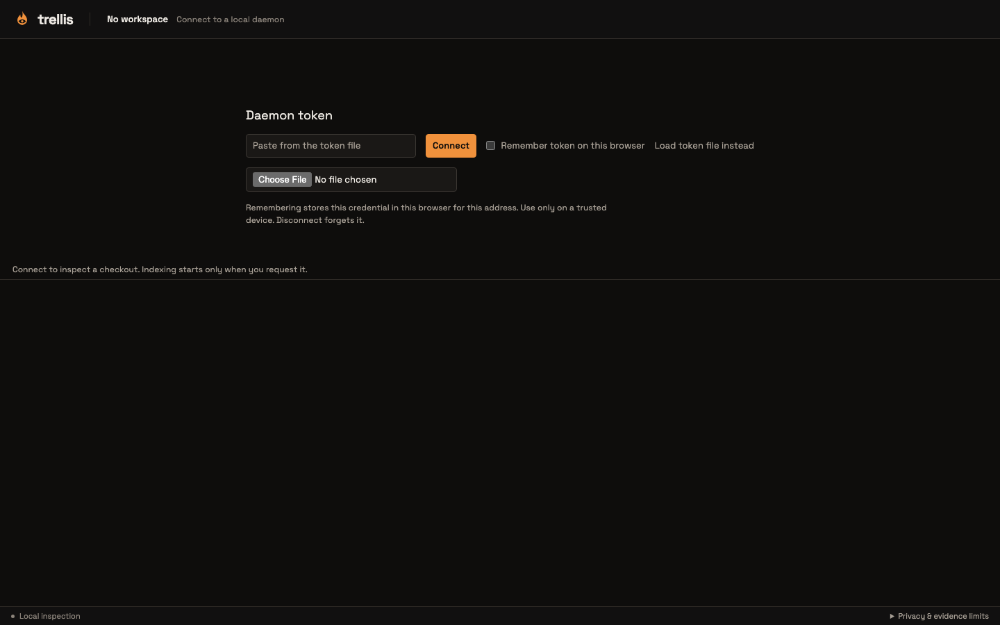 | 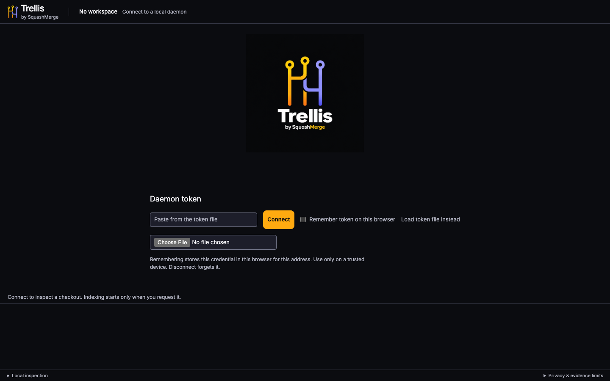 |
| Sequence + inspector | 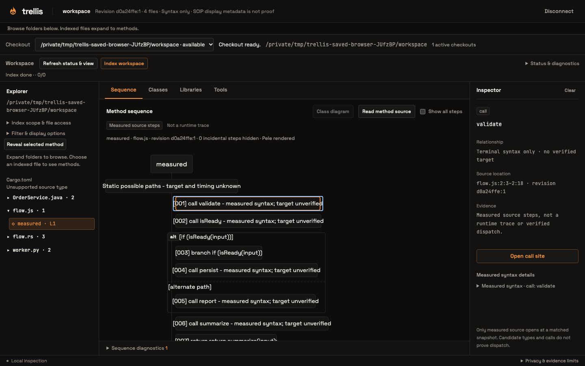 | 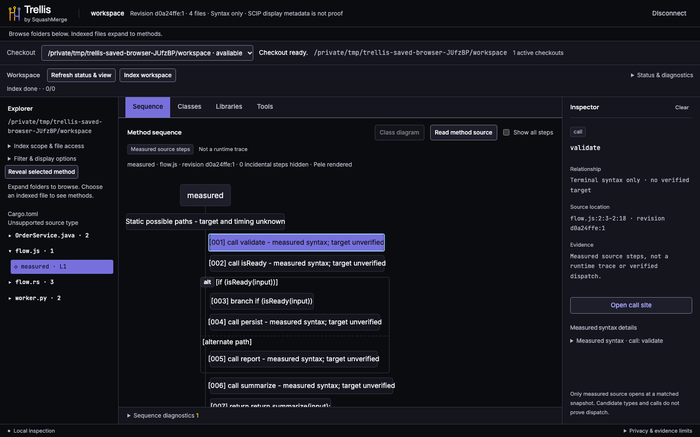 |
| Source dock | 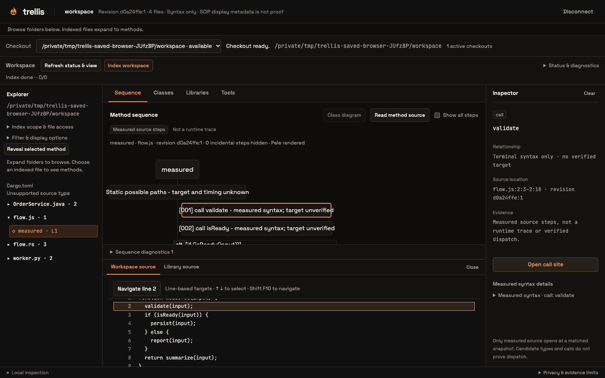 | 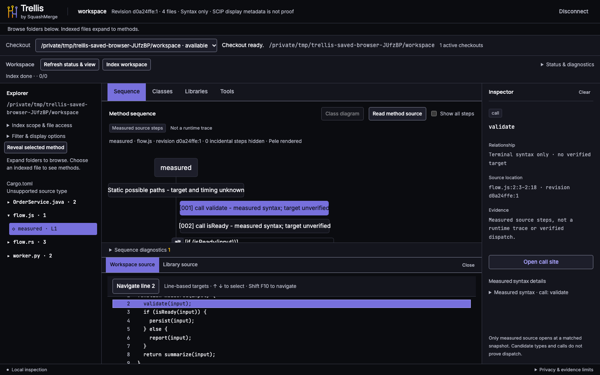 |
| Classes | 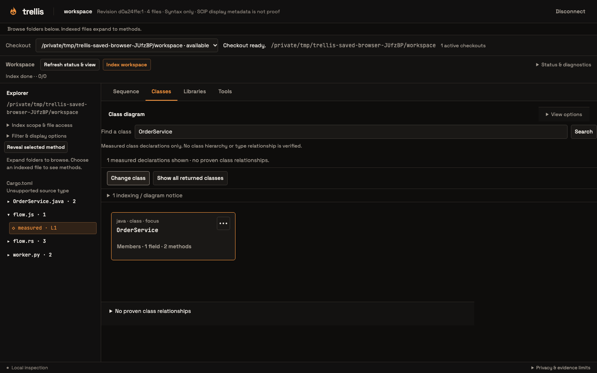 | 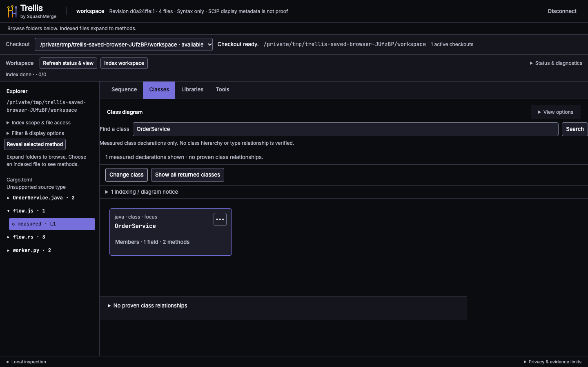 |
| Libraries | 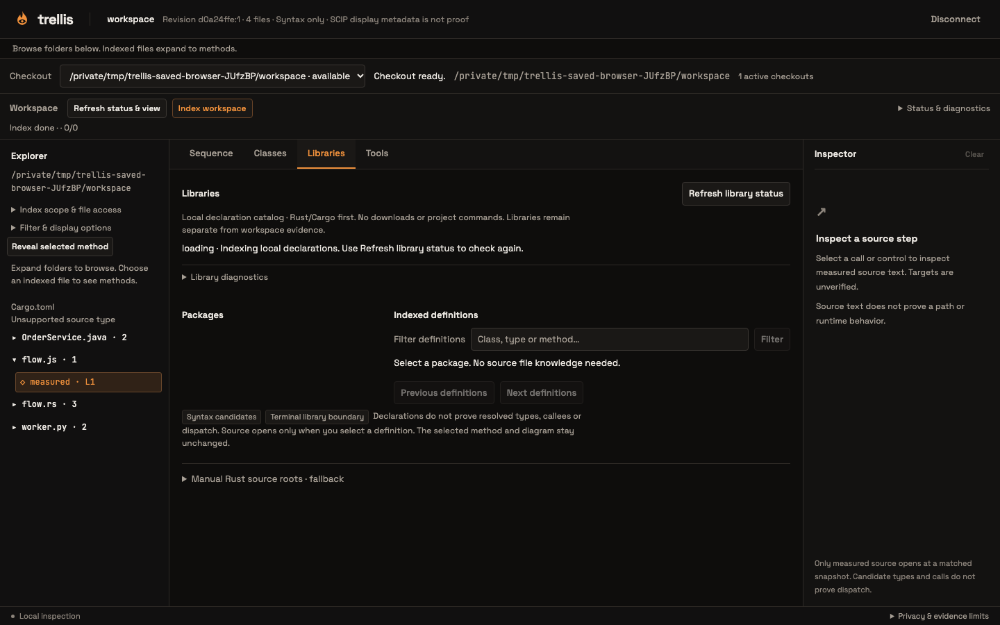 | 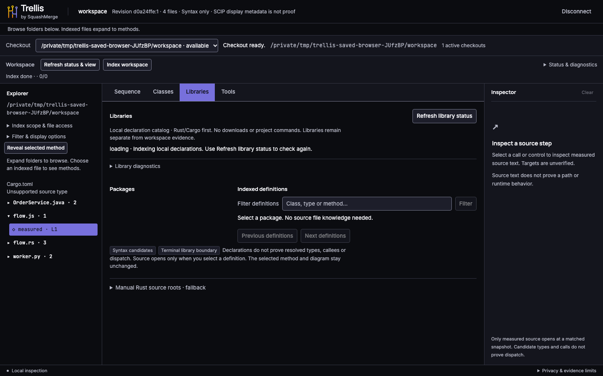 |
| Tools | 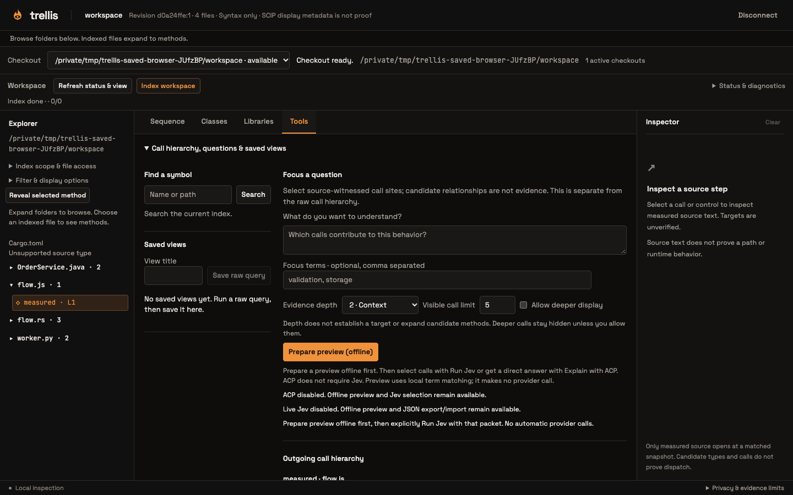 | 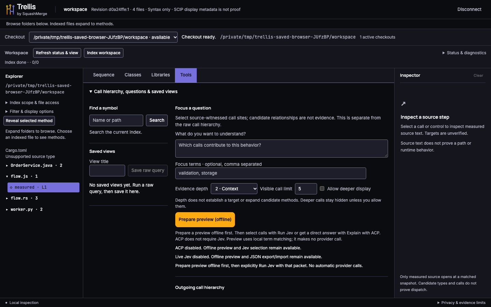 |
| Mobile Connect | 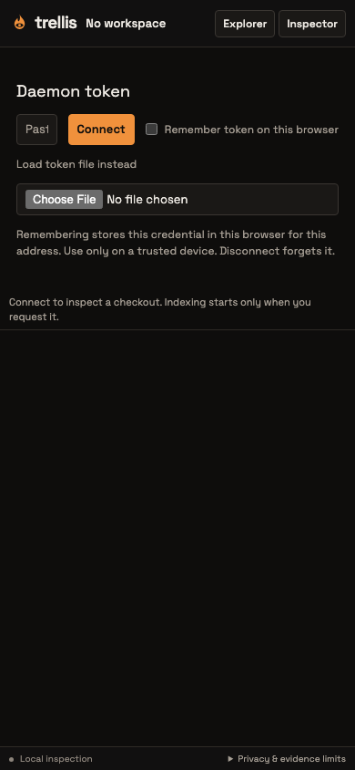 | 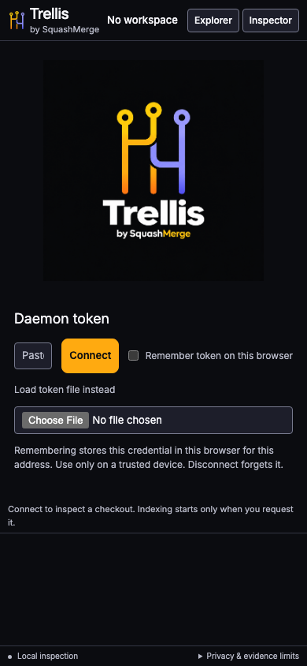 |
| Mobile Sequence | 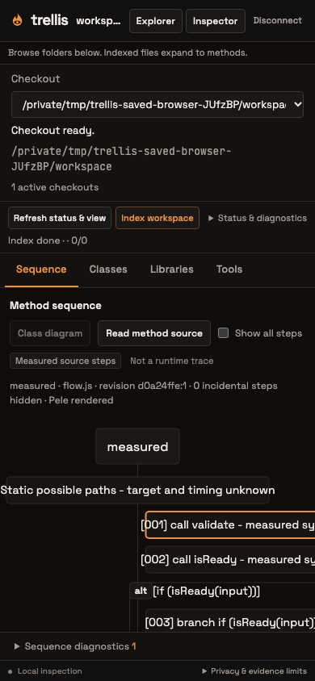 | 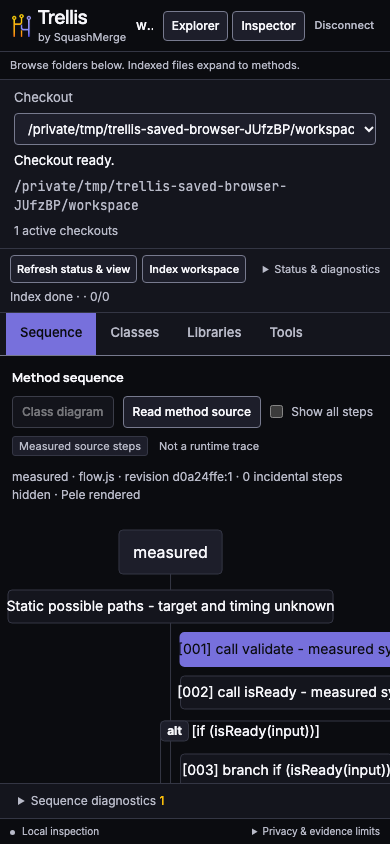 |

The adjacent directories also include mobile inspector and source-dock captures.

## Contrast and local assets

`contrast.json` records real computed/composited colors from the new browser test:

- Primary action text: **10.25:1**.
- Muted notice/help text: **10.14:1**; inspector secondary text: **9.44:1**.
- Selected method, tab, Pele note and highlighted source: **4.78:1**.
- Input/select/button borders: at least **3.90:1** against their fill and **4.29:1**
  against the surrounding surface.
- Keyboard focus is a 2px `#ABA5FF` outline, with a 3px offset.
- Inter, Manrope and JetBrains Mono loaded locally with HTTP 200 and no CSP errors.

Font source pins, SHA-256s, licenses and the full-font Manrope WOFF2 conversion
command are in [`web/fonts/README.md`](../../../../web/fonts/README.md).

Assumption: #304 changes brand treatment, not layout, capabilities or Tools.
The existing compact panes and interactions stay. Palette/font/shape constants
follow the amended design contract; no indexing or evidence constants change.
